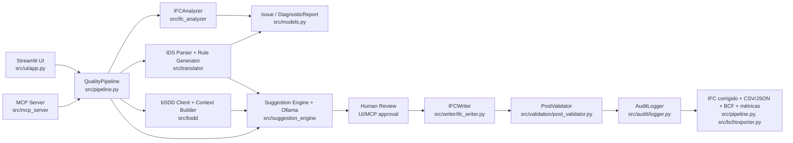
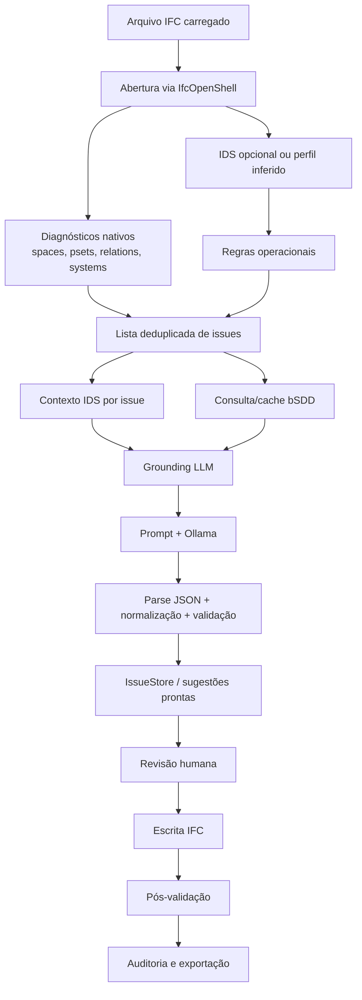

# Dossiê Técnico-Científico do Projeto

## 1. Identificação geral do projeto

O projeto se identifica como **IFC Quality Copilot**. A evidência mais direta está no metadado de empacotamento `pyproject.toml`, que define `name = "ifc-quality-copilot"` e `version = "0.1.0"`, e em documentos internos como `PROJECT_CONTEXT.md`, `CLAUDE.md`, `fase3.md` e `docs/2026-04-17-estado-atual-projeto.md`. A finalidade geral é oferecer um sistema de inspeção, sugestão, revisão humana, correção controlada e auditoria para modelos BIM em formato IFC, usando regras determinísticas, especificações IDS, consulta semântica ao bSDD e geração de sugestões por LLM local via Ollama.

A área de aplicação é BIM/openBIM, qualidade de dados IFC, preparação de modelos para usos posteriores e enriquecimento semântico supervisionado. O sistema atua sobre entidades IFC como `IfcSpace`, `IfcWall`, `IfcSlab`, `IfcDoor`, `IfcWindow`, `IfcBeam`, `IfcColumn`, elementos de sistemas e ativos de operação/manutenção, conforme os diagnósticos em `src/ifc_analyzer/space_diagnostics.py`, `src/ifc_analyzer/pset_diagnostics.py`, `src/ifc_analyzer/relation_diagnostics.py`, `src/ifc_analyzer/system_diagnostics.py` e os extratores em `src/ifc_analyzer/extractors/`.

O tipo de projeto é um protótipo funcional de pesquisa aplicada e engenharia de software. Ele combina biblioteca/pipeline Python, aplicação Streamlit, servidor MCP, camada de validação e scripts experimentais. A interface principal está em `src/ui/app.py`; o orquestrador está em `src/pipeline.py`; as tools MCP ficam em `src/mcp_server/`; e o empacotamento usa Python 3.11+ com dependências científicas e BIM declaradas em `pyproject.toml`.

O problema prático tratado é a baixa qualidade informacional de modelos IFC para usos computacionais posteriores. O repositório materializa esse problema em diagnósticos de espaços com nomes genéricos, propriedades Pset ausentes, relações IFC incompletas, sistemas construtivos não classificados, quantidades ausentes, classificações ausentes, ativos não identificados e dados térmicos incompletos, todos modelados em `src/models.py`. O público-alvo é formado por engenheiros, pesquisadores, estudantes, profissionais BIM e usuários técnicos que precisam revisar um IFC antes de simulação energética, orçamento, facility management, verificação normativa, segurança contra incêndio, acústica ou análise estrutural.

O estado atual é de protótipo/MVP funcional em desenvolvimento. A documentação `docs/2026-04-17-estado-atual-projeto.md` afirma que o pipeline está funcional de ponta a ponta e registra uma suíte automatizada com `717 passed`; nesta análise, essa contagem foi tratada como evidência documental, não como resultado reexecutado. O código confirma módulos implementados para análise, sugestão, escrita, auditoria, validação, exportação BCF, UI e MCP (`src/pipeline.py`, `src/writer/ifc_writer.py`, `src/audit/logger.py`, `src/validation/post_validator.py`, `src/bcf/exporter.py`, `src/ui/app.py`, `src/mcp_server/server.py`). Há, porém, lacunas importantes: ausência de `README.md` identificado na árvore, ausência de `Dockerfile`, cache presente em `data/cache/` sem caracterização como dataset científico, documentação antiga citando `src/rule_engine/*` embora esse diretório não exista na árvore atual, e divergências entre `.env.example` e `src/config.py`.

## 2. Resumo executivo denso

O IFC Quality Copilot é um sistema experimental para diagnóstico e saneamento assistido de modelos IFC. Ele parte da premissa de que modelos BIM frequentemente contêm dados insuficientes, inconsistentes ou pouco normalizados para usos computacionais posteriores. Em vez de tratar o IFC apenas como geometria ou arquivo de intercâmbio, o projeto o trata como um objeto técnico-semântico que precisa satisfazer requisitos mínimos de completude, rastreabilidade e conformidade. Essa intenção aparece no pipeline de qualidade em `src/pipeline.py`, nos perfis de readiness em `src/profiles/`, nos templates IDS em `data/ids_templates/`, no parser IDS em `src/translator/ids_parser.py`, na integração bSDD em `src/bsdd/` e na camada de sugestões por LLM em `src/suggestion_engine/`.

O funcionamento geral pode ser resumido como um ciclo supervisionado: o usuário carrega um arquivo IFC, informa contexto básico da edificação, seleciona um perfil de prontidão ou IDS customizado, executa diagnóstico, recebe issues priorizadas, obtém sugestões de correção, revisa cada sugestão, aplica somente o que aprovar e exporta artefatos de auditoria. Esse fluxo é implementado tanto na UI Streamlit (`src/ui/app.py`, `src/ui/components/sidebar.py`, `src/ui/components/issue_card.py`, `src/ui/components/dashboard.py`) quanto por ferramentas MCP (`src/mcp_server/tools_read.py`, `src/mcp_server/tools_write.py`, `src/mcp_server/tools_pipeline.py`). A revisão humana não é detalhe periférico: as operações de escrita via MCP exigem `aprovado_pelo_usuario`, conforme `src/mcp_server/tools_write.py`, e a UI só aplica correções quando o usuário aceita, edita, pula ou rejeita uma issue, conforme `src/pipeline.py` e `src/ui/components/issue_card.py`.

Do ponto de vista tecnológico, o núcleo é Python 3.11+ (`pyproject.toml`). A leitura e escrita IFC dependem de IfcOpenShell (`pyproject.toml`, `src/ifc_analyzer/analyzer.py`, `src/writer/ifc_writer.py`). A interface usa Streamlit e Plotly (`pyproject.toml`, `src/ui/app.py`, `src/ui/components/dashboard.py`). O LLM é acessado localmente por HTTP via Ollama (`src/suggestion_engine/ollama_client.py`), com parâmetros configuráveis por `src/config.py` e `.env.example`. A conformidade de requisitos usa IDS, com schema em `data/ids_schema/ids.xsd`, templates em `data/ids_templates/` e tradução em regras operacionais em `src/translator/rule_generator.py`. O grounding semântico consulta ou reutiliza bSDD por `src/bsdd/client.py`, `src/bsdd/context_builder.py` e `src/bsdd/cache.py`. A rastreabilidade fica em `src/audit/logger.py`, e a interoperabilidade de issues com fluxos BIM aparece no exportador BCF em `src/bcf/exporter.py`.

O diferencial técnico do projeto é a combinação de quatro camadas: diagnóstico determinístico IFC, requisitos IDS, grounding bSDD e LLM local com normalização defensiva. A LLM não é usada como fonte livre e soberana; ela gera opções que são parseadas, limitadas, normalizadas, validadas semanticamente e registradas. O código explicitamente ignora URI bSDD inventada pelo modelo ao limpar `s.bsdd_uri` antes da validação em `src/suggestion_engine/suggestion.py`, resolve URI somente a partir de contexto confiável em `src/suggestion_engine/normalization.py` e mantém uma política de fontes oficiais em `src/semantic_registry/`. Essa arquitetura torna o projeto relevante para uma narrativa científica sobre uso controlado de LLMs em openBIM, especialmente quando comparado a abordagens que aplicam LLMs diretamente sobre texto ou propriedades IFC sem restrições normativas e sem validação posterior.

> **Nota (revisão bSDD, 2026-08-04):** medido no cache versionado do experimento, o que o bSDD (dicionário IFC 4.3) efetivamente entrega ao grounding é a **classe oficial com URI canônica** e, quando a propriedade existe no dicionário, o **tipo de dado e a URI canônica da propriedade**; `allowed_values` é nulo para todas as propriedades do experimento e definições textuais não são injetadas no prompt. O vocabulário fechado que os modelos veem vem dos **templates de prompt**. Quatro comparações de nome (forma humana do bSDD × PascalCase do IFC) eram no-ops silenciosos e foram corrigidas — em particular, a validação pós-LLM contra vocabulário bSDD passou a executar de fato. Detalhes, censo e delta de instrumento em `docs/revisao-bsdd-2026-08-04.md`.

O projeto já possui material para um artigo técnico-científico sobre enriquecimento semântico supervisionado de IFC com LLMs sob restrições IDS/bSDD. O arquivo `fase3.md` formula uma direção de pesquisa explícita: avaliar quais LLMs locais, operando sob grounding IDS+bSDD, produzem enriquecimento confiável (conformidade pós-IDS, baixa edição humana, zero regressões de schema). O sistema sempre aplica grounding IDS+bSDD — a ablação de grounding foi abandonada (jun/26) e o conceito `grounding_mode` removido do código. Ainda não foi identificado dataset real versionado, ground truth externo, logs experimentais consolidados ou resultados estatísticos no repositório. Existem testes automatizados e framework de avaliação em `tests/evaluation/evaluation_framework.py`, mas ainda falta uma campanha experimental com modelos reais, critérios de amostragem e métricas reportáveis.

Para publicação, as principais melhorias são: consolidar divergências entre documentação e código; disponibilizar ou descrever um conjunto de modelos IFC de avaliação; reexecutar e registrar a suíte de testes; corrigir a comparação de modos de grounding; coletar ground truth de especialistas; medir acurácia top-1/top-3, taxa de aceitação, taxa de edição, redução de issues, tempo de revisão, impacto no readiness e regressões de validação; e explicitar as limitações por domínio. Com isso, o projeto pode virar artigo de engenharia de software aplicada a BIM, artigo de sistemas inteligentes para openBIM ou relatório técnico-científico de validação de pipeline de qualidade IFC assistido por IA.

## 3. Contexto e motivação

O contexto técnico é o ecossistema openBIM, no qual IFC funciona como formato aberto de interoperabilidade entre ferramentas de projeto, análise, orçamento, operação e validação. O repositório mostra foco em IFC por usar IfcOpenShell como dependência central (`pyproject.toml`) e por implementar leitura, inspeção, extração, escrita e validação de entidades IFC em `src/ifc_analyzer/`, `src/writer/ifc_writer.py` e `src/validation/post_validator.py`. O problema de engenharia não é apenas abrir um IFC, mas inferir se suas informações são suficientes para usos específicos: orçamento, energia, operação, conformidade, incêndio, acústica e estrutura, todos representados por perfis em `src/profiles/` e por arquivos IDS em `data/ids_templates/`.

A relevância prática vem do fato de que modelos IFC podem ser visualmente úteis e, ao mesmo tempo, semanticamente incompletos. Um espaço chamado `Room 1`, uma parede sem `Pset_WallCommon.ThermalTransmittance`, uma porta sem `IfcRelFillsElement` ou uma laje sem `LoadBearing` podem impedir simulações, checagens normativas, levantamentos quantitativos ou integração com sistemas de facility management. O projeto concretiza essas dores nos diagnósticos `space_unnamed`, `pset_missing`, `relation_broken`, `system_unclassified`, `quantity_missing`, `classification_missing`, `asset_unidentified` e `thermal_incomplete`, definidos em `src/models.py` e gerados por módulos específicos.

A lacuna acadêmica potencial é o uso controlado de LLMs para enriquecimento semântico IFC. LLMs são úteis para sugerir rótulos, categorias e valores prováveis a partir de contexto textual, mas podem alucinar, produzir valores sem unidade correta ou inventar referências. O projeto ataca essa lacuna ao cercar a LLM por fontes estruturadas: regras de diagnóstico (`src/ifc_analyzer/`), IDS (`src/translator/`), bSDD (`src/bsdd/`), normalização (`src/suggestion_engine/normalization.py`), política de fontes (`src/semantic_registry/`) e pós-validação (`src/validation/post_validator.py`). Isso desloca a contribuição de "LLM sugere texto" para "LLM opera dentro de um pipeline verificável e auditável".

O projeto se conecta a temas maiores da área: qualidade de dados BIM, interoperabilidade IFC, Information Delivery Specification, dicionários semânticos buildingSMART, human-in-the-loop AI, validação pós-edição, rastreabilidade de decisões e preparação de modelos para downstream tasks. O arquivo `fase3.md` aponta explicitamente para a narrativa de enriquecimento semântico de IFC com LLMs sob restrições openBIM. Não foram identificadas referências bibliográficas verificáveis e completas no repositório; portanto, a revisão de literatura deve ser feita posteriormente com fontes externas, sem tratar nomes ou ideias internas como bibliografia consolidada.

## 4. Problema de pesquisa potencial

**Problema central:** modelos IFC frequentemente não têm completude semântica suficiente para usos técnicos especializados, e a correção manual é trabalhosa, sujeita a inconsistências e pouco rastreável. O desafio é saber se um pipeline que combina diagnóstico determinístico, IDS, bSDD, LLM local e revisão humana consegue melhorar a qualidade semântica do IFC sem introduzir regressões.

**Pergunta de pesquisa principal:** quais LLMs locais, operando num pipeline human-in-the-loop com grounding IDS+bSDD, produzem sugestões de correção semântica em modelos IFC com melhor qualidade, rastreabilidade, confiabilidade e eficiência computacional no hardware-alvo?

**Perguntas secundárias:**

- Quais tipos de issues IFC são mais adequados a sugestão por LLM e quais exigem regras determinísticas ou validação humana rígida?
- O uso de IDS e bSDD aumenta a acurácia top-1/top-3 das sugestões em relação a um ground truth de especialistas?
- O pipeline reduz o tempo de revisão manual e a quantidade de edições humanas necessárias?
- A pós-validação por schema, IDS e checks semânticos detecta regressões introduzidas por correções aceitas?
- Perfis de readiness diferentes produzem diagnósticos e prioridades significativamente diferentes para o mesmo modelo?

**Hipótese potencial:** LLMs locais (7–9B quantizados) sob grounding IDS+bSDD atingem conformidade pós-correção e aceitação adequadas ao uso assistido, com zero regressões de schema, e apresentam diferenças mensuráveis de qualidade e eficiência entre famílias — permitindo recomendar quais modelos são viáveis no hardware-alvo. O sistema aplica grounding IDS+bSDD de forma fixa (ablação abandonada).

**Justificativa técnica:** o código já implementa os blocos necessários para avaliar a hipótese: diagnóstico em `src/ifc_analyzer/`, IDS em `src/translator/`, bSDD em `src/bsdd/`, geração LLM em `src/suggestion_engine/`, validação em `src/validation/post_validator.py`, auditoria em `src/audit/logger.py` e avaliação em `tests/evaluation/evaluation_framework.py`.

**Justificativa acadêmica:** o projeto permite investigar confiabilidade de IA generativa em contexto técnico-regulado, onde respostas precisam ser verificáveis, rastreáveis e compatíveis com padrões openBIM. A originalidade depende da comparação com literatura sobre BIM quality checking, semantic enrichment, IDS/bSDD e LLMs para dados estruturados.

**Justificativa prática:** profissionais BIM precisam transformar modelos "visualmente completos" em modelos semanticamente aptos para simulação, orçamento, operação e conformidade. A UI e o MCP mostram duas formas de uso: revisão interativa por engenheiro (`src/ui/app.py`) e automação assistida por agentes/tools (`src/mcp_server/`).

**Possíveis contribuições científicas:** arquitetura de pipeline verificável para enriquecimento semântico IFC; metodologia de avaliação de sugestões LLM em openBIM; conjunto de métricas de readiness por perfil; análise de efeito de IDS/bSDD como grounding; e protocolo de auditoria human-in-the-loop para correções IFC.

> **Contribuição acrescentada em 2026-08-04 — onde fica a fronteira LLM × código.** O estrato térmico deu um caso medido e limpo: o LLM acerta a parte **semântica** (identificar camadas, recuperar λ, escolher o método normativo da NBR 15220-2) e erra a **aritmética** — monta os termos certos e erra a soma, devolvendo fielmente `1/(a soma que ele próprio escreveu)`. O efeito no agregado foi uma queda de 40 pp no top-1 **com top-3 e MAPE praticamente inalterados**: o conhecimento não mudou, mudou qual candidato foi ao 1º lugar. A resposta de engenharia não é prompt melhor, é **tirar a conta do LLM**: ele declara a estrutura, o código executa (`src/suggestion_engine/thermal_recompute.py`). Isso rende (a) um critério objetivo de inconsistência interna — `valor ≠ 1/R_total` pelos próprios termos do modelo, detectável **sem ground truth**; (b) erro diagnosticável em vez de opaco; e (c) um limite declarado — a recomputação conserta a soma, **não** a atribuição de λ. Detalhamento em `docs/condicao-v7-2026-08-04.md` §6.1 e `docs/pontos-de-calculo.md`.

## 5. Objetivos do projeto

### 5.1 Objetivo geral

Desenvolver e avaliar um pipeline assistido por IA para diagnosticar, sugerir, revisar, aplicar, validar e auditar correções semânticas em modelos IFC, com foco em prontidão do modelo para usos técnicos específicos. Esse objetivo é evidenciado pelo orquestrador `QualityPipeline` em `src/pipeline.py`, pela UI em `src/ui/app.py`, pelos perfis em `src/profiles/`, pelos templates IDS em `data/ids_templates/` e pela documentação `PROJECT_CONTEXT.md` e `docs/2026-04-17-estado-atual-projeto.md`.

### 5.2 Objetivos específicos

- Detectar problemas recorrentes de qualidade IFC, como espaços genéricos, Psets ausentes, relações quebradas e sistemas não classificados, conforme `src/ifc_analyzer/space_diagnostics.py`, `src/ifc_analyzer/pset_diagnostics.py`, `src/ifc_analyzer/relation_diagnostics.py` e `src/ifc_analyzer/system_diagnostics.py`.
- Traduzir requisitos IDS em regras operacionais aplicáveis ao IFC, usando `parse_ids()` em `src/translator/ids_parser.py` e `generate_rules()`/`apply_rules()` em `src/translator/rule_generator.py`.
- Construir contexto semântico com IDS e bSDD para reduzir alucinação e orientar sugestões, conforme `src/bsdd/context_builder.py`, `src/bsdd/client.py` e `src/suggestion_engine/grounding.py`.
- Gerar sugestões por LLM local via Ollama, parsear JSON, limitar opções, normalizar valores e validar compatibilidade, conforme `src/suggestion_engine/ollama_client.py`, `src/suggestion_engine/prompt_templates.py`, `src/suggestion_engine/suggestion.py` e `src/suggestion_engine/normalization.py`.
- Aplicar correções no IFC apenas por decisão humana e registrar auditoria, conforme `src/writer/ifc_writer.py`, `src/pipeline.py`, `src/audit/logger.py` e `src/mcp_server/tools_write.py`.
- Exportar IFC corrigido, auditoria, métricas e BCF, conforme `QualityPipeline.export()` em `src/pipeline.py` e `src/bcf/exporter.py`.

### 5.3 Objetivos técnicos implementados

Estão implementados: análise IFC; extração de quantidades, térmica, classificação, ativos e contexto universal; perfis de readiness; parser IDS; rule generator; integração bSDD com cache; prompt router e templates especializados; cliente Ollama; fila assíncrona de sugestões; cache SQLite de sugestões; deduplicação e reuso seguro; escrita IFC; pós-validação; auditoria CSV/JSON; exportação BCF; UI Streamlit; servidor MCP stdio e HTTP; e framework de avaliação em testes. As evidências estão em `src/ifc_analyzer/`, `src/profiles/`, `src/translator/`, `src/bsdd/`, `src/suggestion_engine/`, `src/writer/ifc_writer.py`, `src/validation/post_validator.py`, `src/audit/logger.py`, `src/bcf/exporter.py`, `src/ui/`, `src/mcp_server/` e `tests/evaluation/evaluation_framework.py`.

### 5.4 Objetivos ainda não implementados

Ainda não há, no repositório, um dataset científico versionado, ground truth de especialistas, notebooks de análise estatística, relatórios de experimentos com múltiplos modelos reais, Dockerfile ou README de reprodução. Também há perfis com `ids_filename` sem arquivo correspondente, como `fm_readiness.ids` e `compliance_readiness.ids`, referenciados em `src/profiles/fm/__init__.py` e `src/profiles/compliance/__init__.py`, mas não identificados em `data/ids_templates/`. Há ainda `location_missing` em perfis HVAC/FM (`src/profiles/hvac/__init__.py`, `src/profiles/fm/__init__.py`) sem estar listado no `Literal` de `Issue.issue_type` em `src/models.py`.

## 6. Visão geral da arquitetura

A arquitetura é modular e gira em torno de `QualityPipeline`. O pipeline instancia o analisador IFC, writer, audit logger, cliente Ollama, cache de sugestões, gerador de sugestões, deduplicador, cliente bSDD, construtor de contexto bSDD, pós-validador e exportador BCF (`src/pipeline.py`). A execução pode ser acionada pela UI Streamlit (`src/ui/app.py`) ou pelo MCP (`src/mcp_server/tools_pipeline.py`). A camada de domínio usa modelos Pydantic em `src/models.py`.





| Módulo | Responsabilidade | Arquivos associados |
|---|---|---|
| Modelos de domínio | Representar IFCElement, Issue, Suggestion, IDSContext, BSDDContext, AuditEntry, ReadinessProfile e DiagnosticReport | `src/models.py` |
| Pipeline | Orquestrar diagnóstico, IDS, bSDD, LLM, revisão, escrita, validação e exportação | `src/pipeline.py` |
| Analisador IFC | Abrir IFC e gerar issues determinísticas com contexto | `src/ifc_analyzer/analyzer.py`, `src/ifc_analyzer/*_diagnostics.py` |
| Extratores | Extrair quantidades, dados térmicos, classificações, ativos e contexto universal | `src/ifc_analyzer/extractors/`, `src/ifc_analyzer/universal_extractor.py` |
| IDS/tradutor | Parsear IDS e converter requirements em regras executáveis | `src/translator/ids_parser.py`, `src/translator/rule_generator.py`, `src/translator/pset_resolver.py` |
| bSDD/semântica | Resolver classes/propriedades e construir grounding confiável | `src/bsdd/`, `src/semantic_registry/`, `src/semantic/canonical_uris.py` |
| Sugestões LLM | Criar prompts, chamar Ollama, parsear, normalizar, validar, cachear e processar em background | `src/suggestion_engine/` |
| Escrita IFC | Aplicar correções controladas no arquivo IFC | `src/writer/ifc_writer.py` |
| Validação | Validar schema, IDS e semântica após escrita | `src/validation/post_validator.py` |
| Auditoria | Registrar decisões, valores, fonte, grounding, prompt hash e pós-validação | `src/audit/logger.py` |
| UI | Permitir upload, seleção de perfil, revisão, dashboard e exportação | `src/ui/` |
| MCP | Expor diagnóstico, pipeline e escrita como tools | `src/mcp_server/` |
| BCF | Exportar issues em BCFXML 3.0 | `src/bcf/exporter.py` |
| Experimentos/avaliação | Métricas simples e framework de avaliação com ground truth | `src/experiment/`, `tests/evaluation/evaluation_framework.py` |

## 7. Mapa completo do repositório

`src/` contém o código principal. `src/pipeline.py` é o núcleo de orquestração. `src/models.py` define os contratos de dados. `src/config.py` centraliza configurações via Pydantic Settings. `src/ifc_analyzer/` implementa diagnósticos e extração IFC. `src/translator/` implementa o caminho IDS -> regras operacionais. `src/bsdd/` e `src/semantic_registry/` cuidam do grounding semântico. `src/suggestion_engine/` concentra LLM, prompts, normalização, cache, fila e deduplicação. `src/writer/`, `src/validation/`, `src/audit/` e `src/bcf/` tratam aplicação, validação, rastreabilidade e exportação. `src/ui/` implementa a aplicação Streamlit. `src/mcp_server/` expõe interface de agente. `src/profiles/` define perfis de readiness.

`data/` contém artefatos de dados e padrões. `data/ids_templates/` guarda IDS de readiness (`budget_readiness.ids`, `energy_readiness.ids`, `fire_safety_readiness.ids`, `acoustic_readiness.ids`, `structural_readiness.ids`, `residencial_nbr15575.ids`). `data/ids_schema/ids.xsd` é usado para validação IDS. `data/cache/` contém `bsdd_cache.json` e `suggestion_cache.db`, que são caches operacionais, não datasets científicos validados.

`tests/` contém uma suíte extensa de testes unitários e de integração. Ela cobre modelos, configuração, diagnóstico, extratores, IDS, bSDD, grounding, sugestão, normalização, cache, worker, writer, pós-validação, auditoria, BCF, MCP e pipeline. `tests/conftest.py` cria modelos IFC sintéticos em memória com espaços, paredes, portas, lajes, relações e casos de borda. `tests/evaluation/` contém um framework de avaliação contra ground truth.

`docs/` contém documentação interna. `docs/2026-04-17-estado-atual-projeto.md` registra o estado funcional e menciona `717 passed`. `docs/superpowers/` contém planos e especificações de desenvolvimento, como parser IDS, robustez de regras, perfis e templates. `docs/prompts_log/` existe, mas não foram identificados arquivos relevantes durante a varredura.

`scripts/` contém `scripts/test_bsdd_live.py`, um script manual para consultar a API pública bSDD e inspecionar classes `IfcWall`, `IfcSpace` e `IfcSlab`.

Arquivos raiz relevantes: `pyproject.toml` define pacote, dependências e ferramentas; `.env.example` define variáveis de ambiente; `Makefile` define comandos de instalação, teste, lint, UI e MCP; `PROJECT_CONTEXT.md`, `CLAUDE.md` e `fase3.md` documentam visão, arquitetura esperada, modo de trabalho e ambição científica; `run_mcp_claude.bat` executa `python -m src.mcp_server.server` em caminho local fixo; `logoIME.png` e `logoIME.cdr` são assets de identidade visual. Não foi identificado `README.md` na raiz.

## 8. Tecnologias, dependências e ambiente

O ambiente esperado é Python 3.11 ou superior, com dependências instaladas a partir de `pyproject.toml`. A execução principal depende de IfcOpenShell para manipular IFC, Streamlit para UI, Ollama para LLM local, MCP para tools, Pydantic para modelos/configuração, Loguru para logging, Plotly para dashboard, HTTPX para API bSDD/Ollama, Starlette/Uvicorn para MCP HTTP e lxml para XML/BCF/IDS.

| Tecnologia | Onde aparece | Função no projeto | Evidência |
|---|---|---|---|
| Python 3.11+ | Configuração do pacote | Linguagem principal | `pyproject.toml` |
| IfcOpenShell | Análise, escrita e validação IFC | Abrir, consultar, criar/editar entidades IFC | `pyproject.toml`, `src/ifc_analyzer/analyzer.py`, `src/writer/ifc_writer.py` |
| Streamlit | Interface web local | Upload, revisão, dashboard e exportação | `pyproject.toml`, `src/ui/app.py` |
| Plotly | Dashboard visual | Gráficos de issues, severidade, status e readiness | `pyproject.toml`, `src/ui/components/dashboard.py` |
| Ollama | LLM local | Geração de sugestões JSON | `pyproject.toml`, `src/suggestion_engine/ollama_client.py`, `.env.example` |
| Pydantic / pydantic-settings | Modelos e settings | Validação de dados e env vars | `pyproject.toml`, `src/models.py`, `src/config.py` |
| MCP | Integração com agentes | Tools de diagnóstico, pipeline e escrita | `pyproject.toml`, `src/mcp_server/` |
| HTTPX | Cliente HTTP | Chamadas Ollama e bSDD | `pyproject.toml`, `src/suggestion_engine/ollama_client.py`, `src/bsdd/client.py` |
| Starlette/Uvicorn | Servidor HTTP MCP | Endpoint `/mcp` e `/health` | `pyproject.toml`, `src/mcp_server/http_server.py` |
| lxml | XML/BCF/IDS | Serialização BCF e XML | `pyproject.toml`, `src/bcf/exporter.py` |
| buildingSMART IDS | Requisitos de informação | Templates e validação XSD | `data/ids_templates/`, `data/ids_schema/ids.xsd`, `src/translator/ids_parser.py` |
| bSDD | Dicionário semântico | Grounding oficial de classes/propriedades | `src/bsdd/client.py`, `src/bsdd/context_builder.py` |
| SQLite | Cache de sugestões | Reuso de sugestões por assinatura | `src/suggestion_engine/suggestion_cache.py`, `data/cache/suggestion_cache.db` |
| JSON cache | Cache bSDD | Persistência simples de respostas bSDD | `src/bsdd/cache.py`, `data/cache/bsdd_cache.json` |
| pytest | Testes | Suíte automatizada | `pyproject.toml`, `tests/` |
| Ruff/Mypy | Qualidade estática | Lint, format e type checking | `pyproject.toml`, `Makefile` |

Hardware específico não foi identificado. Como o LLM roda via Ollama, a necessidade de CPU/GPU/RAM depende do modelo local usado. `.env.example` sugere `deepseek-r1:8b`, enquanto `src/config.py` usa por padrão `qwen3.5:9b`; essa divergência precisa ser resolvida antes de um artigo reproduzível.

## 9. Instalação e execução

O caminho de instalação inferido é:

```bash
pip install -e ".[dev]"
```

Esse comando aparece no target `install` do `Makefile`. A execução da UI é:

```bash
streamlit run src/ui/app.py
```

Esse comando aparece em `Makefile` como `run-ui`. O servidor MCP stdio é:

```bash
python -m src.mcp_server.server
```

Esse comando aparece em `Makefile` e em `run_mcp_claude.bat`. O servidor MCP HTTP é:

```bash
python -m src.mcp_server.http_server
```

O `Makefile` também define `test` (`pytest -v --tb=short`), `test-cov`, `lint` (`ruff check src/ tests/ && mypy src/`), `format` e `clean`. O target `clean` usa sintaxe Unix (`rm -rf`), o que pode ser frágil em Windows sem shell compatível.

As variáveis de ambiente estão em `.env.example`: `OLLAMA_URL`, `OLLAMA_MODEL`, `OLLAMA_TEMPERATURE`, `OLLAMA_NUM_CTX`, `OLLAMA_NUM_PREDICT`, `OLLAMA_THINK`, `OLLAMA_TIMEOUT_SECONDS`, `OLLAMA_MAX_RETRIES`, `POST_VALIDATION_ENABLED`, `BSDD_API_BASE`, `BSDD_CACHE_PATH`, `IDS_XSD_PATH`, `IFC_UPLOAD_DIR` e `LOG_LEVEL`. O código usa `src/config.py` para carregar esses valores.

Pontos frágeis: não há `README.md` identificado; não há Dockerfile; o `.env.example` diverge de `src/config.py` no modelo padrão; e alguns perfis referenciam IDS inexistentes. Para reprodução científica, esses pontos devem ser corrigidos ou explicitados.

## 10. Funcionamento interno detalhado

### Modelos de domínio

- Arquivos relacionados: `src/models.py`.
- Responsabilidade: definir contratos de dados para elementos IFC, issues, sugestões, contexto IDS/bSDD, validação, auditoria, relatórios e perfis.
- Entradas: dados extraídos do IFC, requisitos IDS, respostas bSDD, respostas LLM e decisões humanas.
- Saídas: objetos Pydantic usados por todo o sistema.
- Principais funções/classes: `IFCElement`, `Issue`, `Suggestion`, `SuggestionSet`, `BSDDContext`, `IDSContext`, `ValidationResult`, `AuditEntry`, `DiagnosticReport`, `OperationalRule`, `ReadinessProfile`, `ReadinessScore`, `ProfileRegistry`.
- Explicação detalhada: `Issue` organiza cada não conformidade com GUID, classe IFC, tipo, severidade, descrição, contexto, status e valor resolvido. `SuggestionSet` limita e ordena sugestões por confiança. `OperationalRule` representa um requisito IDS convertido para execução sobre IFC e gera `IDSContext`. `ReadinessScore.compute()` calcula prontidão com base em issues, severidades bloqueantes e total de verificações.
- Papel no projeto: fornece a linguagem comum entre analisador, pipeline, UI, MCP, LLM, writer e auditoria.
- Possíveis melhorias: alinhar `Issue.issue_type` com todos os perfis; incluir `location_missing` ou removê-lo dos perfis; permitir `source` diferente de `"llm"` (ex.: fonte determinística) se necessário.
- Evidências no repositório: `src/models.py`, `src/profiles/hvac/__init__.py`, `src/profiles/fm/__init__.py`.

### Configuração

- Arquivos relacionados: `src/config.py`, `.env.example`.
- Responsabilidade: centralizar parâmetros de Ollama, bSDD, cache, IDS, upload, logging e validação.
- Entradas: variáveis de ambiente e defaults.
- Saídas: instância `Settings` cacheada por `get_settings()`.
- Principais funções/classes: `Settings`, `get_settings`.
- Explicação detalhada: `Settings` define URL/modelo do Ollama, temperatura, contexto, predição, retries, seed, top_p, repeat_penalty, cache de sugestões, bSDD, grounding e pós-validação. `.env.example` documenta valores de uso esperado, mas seus defaults divergem de `src/config.py`.
- Papel no projeto: permite trocar modelo, endpoint, cache e validação sem alterar código.
- Possíveis melhorias: alinhar `.env.example` com `src/config.py`; documentar requisitos de modelo; separar parâmetros experimentais dos operacionais.
- Evidências: `src/config.py`, `.env.example`.

### Pipeline de qualidade

- Arquivos relacionados: `src/pipeline.py`.
- Responsabilidade: coordenar diagnóstico, integração IDS, bSDD, geração de sugestões, revisão, escrita, validação, auditoria e exportação.
- Entradas: caminho IFC, contexto da edificação, perfil/IDS opcional e modo de grounding.
- Saídas: `DiagnosticReport`, sugestões, correções aplicadas, artefatos exportados.
- Principais funções/classes: `QualityPipeline`, `diagnose()`, `_integrate_ids()`, `generate_suggestions()`, `diagnose_and_start_suggestions()`, `apply_correction()`, `export()`, `compute_readiness()`.
- Explicação detalhada: ao inicializar, o pipeline abre o IFC via `IFCAnalyzer`, reaproveita o `ifc_file` no `IFCWriter`, cria auditoria, cliente LLM, cache, gerador, deduplicador, cliente bSDD, construtor bSDD, pós-validador e BCF exporter. `diagnose()` gera issues nativas e integra IDS se houver caminho de IDS. `_integrate_ids()` parseia IDS, gera regras, aplica regras e deduplica issues por tupla de GUID, tipo e propriedade. `diagnose_and_start_suggestions()` cria `IssueStore`, prepara grounding, calcula reuso por assinatura e inicia `SuggestionWorker`. `apply_correction()` normaliza valor, escreve no IFC, pós-valida, registra auditoria e marca a issue como resolvida.
- Papel no projeto: é o eixo operacional e a principal evidência de sistema funcional.
- Possíveis melhorias: reverter escrita quando pós-validação falhar ou documentar por que não reverte; tornar explícito quando schema check está desabilitado; tratar `material_unmapped`; resolver inconsistência de IDS ausentes.
- Evidências: `src/pipeline.py`, `src/experiment/runner.py`.

### Analisador IFC

- Arquivos relacionados: `src/ifc_analyzer/analyzer.py`, `src/ifc_analyzer/space_diagnostics.py`, `src/ifc_analyzer/pset_diagnostics.py`, `src/ifc_analyzer/relation_diagnostics.py`, `src/ifc_analyzer/system_diagnostics.py`.
- Responsabilidade: abrir o IFC e gerar issues determinísticas.
- Entradas: arquivo IFC.
- Saídas: `DiagnosticReport` com issues e contagens.
- Principais funções/classes: `IFCAnalyzer`, `analyze()`, `analyze_for_profile()`, `analyze_from_ids()`, `diagnose_spaces()`, `diagnose_psets()`, `diagnose_relations()`, `diagnose_systems()`.
- Explicação detalhada: `IFCAnalyzer.analyze()` executa diagnósticos de espaços, Psets, relações e sistemas. O diagnóstico de espaços detecta nomes genéricos por regex e usa contexto funcional de área, elementos contidos e adjacências. O diagnóstico de Psets verifica propriedades obrigatórias por classe e trata valores vazios ou inválidos. Relações verificam portas/janelas sem `IfcRelFillsElement`, órfãos sem contenção espacial e baixa cobertura de `IfcRelSpaceBoundary`. Sistemas verificam ausência de classificação ou Psets padronizados de material em paredes/lajes.
- Papel no projeto: produz o backlog inicial que será enriquecido por IDS/bSDD/LLM.
- Possíveis melhorias: parametrizar regras por domínio; medir precisão dos diagnósticos; ampliar classes IFC; diferenciar diagnóstico global de requisito IDS.
- Evidências: arquivos citados e testes `tests/test_analyzer.py`, `tests/test_pset_diagnostics.py`, `tests/test_relation_diagnostics.py`, `tests/test_system_diagnostics.py`.

### Extratores especializados

- Arquivos relacionados: `src/ifc_analyzer/extractors/quantity_extractor.py`, `thermal_extractor.py`, `classification_extractor.py`, `asset_extractor.py`, `src/ifc_analyzer/universal_extractor.py`.
- Responsabilidade: enriquecer issues com contexto técnico.
- Entradas: entidades IFC.
- Saídas: dicionários de quantidades, propriedades térmicas, classificações, ativos, materiais, Psets e espacialização.
- Principais funções/classes: `QuantityExtractor`, `ThermalExtractor`, `ClassificationExtractor`, `AssetExtractor`, `UniversalExtractor`.
- Explicação detalhada: `QuantityExtractor` lê Qto e usa fallback geométrico quando possível. `ThermalExtractor` estima informações de envoltória, camadas, isolamento e WWR. `ClassificationExtractor` lê `IfcClassificationReference` e sugere categoria por palavras-chave de material. `AssetExtractor` identifica equipamentos sem fabricante/modelo/série/localização. `UniversalExtractor` oferece contexto genérico quando um IDS customizado exige informação fora dos extratores especializados.
- Papel no projeto: fornece dados para diagnóstico, prompts e reuso seguro de sugestões.
- Possíveis melhorias: alinhar `required_extractors` dos perfis com os nomes aceitos por `IFCAnalyzer.get_extractor()`, pois há nomes em perfis que não correspondem a extratores implementados.
- Evidências: arquivos citados, `src/profiles/registry.py`, `tests/test_extractors.py`, `tests/test_quantity_extractor.py`, `tests/test_thermal_extractor.py`.

### Parser IDS e gerador de regras

- Arquivos relacionados: `src/translator/ids_parser.py`, `src/translator/rule_generator.py`, `src/translator/pset_resolver.py`, `data/ids_schema/ids.xsd`, `data/ids_templates/`.
- Responsabilidade: transformar especificações IDS em regras operacionais aplicáveis ao IFC.
- Entradas: arquivos `.ids`.
- Saídas: `IDSSpecification`, `OperationalRule` e issues derivadas de regras.
- Principais funções/classes: `parse_ids()`, `generate_rules()`, `apply_rules()`, `resolve_property()`, `normalize_numeric_value()`.
- Explicação detalhada: o parser lê XML IDS, valida XSD quando disponível, extrai entidades, filtros e requisitos de propriedade, atributo, relação, material, classificação e `partOf`. O gerador infere tipo de check, tipo de issue, severidade, ação de escrita e contexto requerido. O resolvedor de Psets busca propriedades com aliases para termos como `ThermalTransmittance`, `FireRating`, `IsExternal` e `LoadBearing`.
- Papel no projeto: converte requisitos de domínio em verificações automáticas e fornece grounding normativo para LLM.
- Possíveis melhorias: ampliar suporte a relações IDS que hoje podem ser parcialmente ignoradas em `_passes_check()`; reportar cobertura de facets; consolidar templates faltantes.
- Evidências: arquivos citados, `tests/test_translator.py`, `tests/test_rule_generator.py`, `tests/test_ids_xsd.py`.

### Perfis de readiness

- Arquivos relacionados: `src/profiles/`, `data/ids_templates/`.
- Responsabilidade: agrupar issue types, extratores, severidades bloqueantes e IDS por uso técnico.
- Entradas: seleção de perfil na UI/MCP ou IDS customizado.
- Saídas: `ReadinessProfile` e `ReadinessScore`.
- Principais funções/classes: `create_default_registry()`, `load_custom_profile_from_ids()`, `build_profile()` em cada subpasta.
- Explicação detalhada: há perfis base, IDS genérico, orçamento, energia, HVAC, FM, compliance, incêndio, acústica e estrutural. Perfis orçamento/energia/incêndio/acústica/estrutural têm IDS identificados em `data/ids_templates/`; FM e compliance referenciam arquivos não identificados. A UI permite escolher perfil e exibe score de readiness.
- Papel no projeto: liga qualidade IFC a usos finais concretos.
- Possíveis melhorias: resolver perfis sem IDS; remover ou implementar `location_missing`; alinhar enum MCP com todos os perfis atuais.
- Evidências: `src/profiles/registry.py`, subpastas de `src/profiles/`, `src/ui/components/sidebar.py`, `src/mcp_server/tools_read.py`.

### bSDD e registro semântico

- Arquivos relacionados: `src/bsdd/client.py`, `src/bsdd/context_builder.py`, `src/bsdd/cache.py`, `src/semantic_registry/`, `src/semantic/canonical_uris.py`.
- Responsabilidade: obter candidatos e referências oficiais para classes/propriedades IFC.
- Entradas: issue, contexto IDS, domínio bSDD.
- Saídas: `BSDDContext`, candidatos de classes/propriedades, URIs canônicas.
- Principais funções/classes: `BSDDClient`, `BSDDContextBuilder`, `BSDDCacheStore`, `SourcePolicy`, `CanonicalURIResolver`.
- Explicação detalhada: o cliente bSDD usa HTTPX e cache JSON. O context builder decide consultas por tipo de issue e combina IDS/bSDD. O registro semântico define fontes oficiais buildingSMART/IfcOpenShell/BCF e classifica links oficiais, secundários ou proibidos. O resolvedor constrói URIs canônicas IFC em `https://identifier.buildingsmart.org/uri/buildingsmart/ifc/4.3`.
- Papel no projeto: reduzir invenção semântica pela LLM e sustentar rastreabilidade.
- Possíveis melhorias: capturar versão/resposta bSDD em logs experimentais; lidar com indisponibilidade da API; medir cobertura semântica por tipo de issue.
- Evidências: arquivos citados, `scripts/test_bsdd_live.py`, `tests/test_bsdd_client.py`, `tests/test_bsdd_context_builder.py`, `tests/test_source_policy.py`.

### Motor de sugestões

- Arquivos relacionados: `src/suggestion_engine/`.
- Responsabilidade: gerar, validar, cachear e processar sugestões de correção.
- Entradas: issue, contexto do edifício, IDSContext, BSDDContext, perfil.
- Saídas: `SuggestionSet` com até três sugestões.
- Principais funções/classes: `SuggestionGenerator`, `OllamaClient`, `prepare_llm_grounding()`, `build_prompt()`, `build_compact_prompt()`, `parse_llm_response()`, `normalize_suggestion_value()`, `SuggestionCache`, `IssueStore`, `SuggestionWorker`, `IssueDeduplicator`.
- Explicação detalhada: o gerador prepara grounding, calcula assinatura de cache, constrói prompt compacto ou roteado, chama Ollama, parseia JSON, normaliza valores, remove duplicatas, valida contra bSDD e marca revisão obrigatória quando não há candidatos oficiais. O worker processa fila em background, respeita prioridade por perfil/severidade e reutiliza sugestões entre issues estruturalmente equivalentes quando seguro.
- Papel no projeto: traduz diagnóstico em opções acionáveis para revisão humana.
- Possíveis melhorias: registrar taxa de descarte por normalização; documentar prompts finais usados em experimentos; resolver divergência entre `PROMPT_VERSION` em módulos (`src/suggestion_engine/suggestion_cache.py` e importações).
- Evidências: `src/suggestion_engine/suggestion.py`, `src/suggestion_engine/ollama_client.py`, `src/suggestion_engine/prompt_templates.py`, `src/suggestion_engine/grounding.py`, `src/suggestion_engine/normalization.py`, `src/suggestion_engine/worker.py`.

### Writer IFC

- Arquivos relacionados: `src/writer/ifc_writer.py`.
- Responsabilidade: aplicar correções no IFC com coerção defensiva.
- Entradas: GUID, tipo de operação e valor aprovado.
- Saídas: IFC modificado em memória e, posteriormente, arquivo salvo.
- Principais funções/classes: `IFCWriter`, `renomear_espaco()`, `preencher_pset()`, `criar_relacao_fills()`, `classificar_sistema()`, `preencher_base_quantities()`, `mapear_classificacao()`, `associar_zona_termica()`, `salvar()`.
- Explicação detalhada: o writer valida classe IFC, cria/edita Psets e Qto via `ifcopenshell.api`, cria relações de abertura/filling, associa classificações e zonas térmicas, e normaliza valores críticos como transmitância térmica e `FireRating`.
- Papel no projeto: transforma decisão humana em alteração IFC rastreável.
- Possíveis melhorias: aumentar granularidade de rollback; validar schema completo após lote; mapear mais ações para tipos de issue.
- Evidências: `src/writer/ifc_writer.py`, `tests/test_writer.py`.

### Pós-validação

- Arquivos relacionados: `src/validation/post_validator.py`.
- Responsabilidade: verificar se a correção aplicada não viola schema, IDS ou semântica.
- Entradas: GUID corrigido e arquivo IFC em memória.
- Saídas: `ValidationResult`.
- Principais funções/classes: `PostValidator`, `validate_element()`, `_run_schema_check()`, `_run_ids_revalidation()`, `_run_semantic_checks()`.
- Explicação detalhada: o validador pode executar validação schema via IfcOpenShell, reexecutar regras IDS aplicáveis e checar semântica de propriedades como `ThermalTransmittance` e `FireRating`. No pipeline, a validação de schema em cada elemento aparece desabilitada por parâmetro, exigindo cuidado ao reportar robustez.
- Papel no projeto: fecha o ciclo de confiança pós-escrita.
- Possíveis melhorias: habilitar schema check em experimentos; registrar falhas e rollback efetivo; ampliar checks por propriedade.
- Evidências: `src/validation/post_validator.py`, `src/pipeline.py`, `tests/test_post_validator.py`.

### Auditoria e BCF

- Arquivos relacionados: `src/audit/logger.py`, `src/bcf/exporter.py`.
- Responsabilidade: registrar decisões e exportar issues interoperáveis.
- Entradas: correções, decisões, contexto e resultados de validação.
- Saídas: CSV, JSONL/JSON, resumo e BCF ZIP.
- Principais funções/classes: `AuditLogger`, `AuditEntry`, `BCFExporter`.
- Explicação detalhada: a auditoria registra usuário, valor antigo, valor novo, ação, confiança, fonte, modo de grounding, fontes, URI bSDD, requisito IDS, pós-validação e hash de prompt. O BCF exporter cria tópicos por issue em BCFXML 3.0 com prioridade derivada de severidade.
- Papel no projeto: torna o processo rastreável e comunicável em fluxos BIM.
- Possíveis melhorias: revisar uso de GUID em campos BCF que podem exigir GUID de projeto; adicionar viewpoints quando houver geometria.
- Evidências: arquivos citados, `tests/test_audit.py`, `tests/test_audit_provenance.py`, `tests/test_bcf_exporter.py`.

### UI Streamlit

- Arquivos relacionados: `src/ui/app.py`, `src/ui/styles.py`, `src/ui/components/`.
- Responsabilidade: oferecer experiência interativa para upload, configuração, revisão, dashboard e exportação.
- Entradas: arquivo IFC, perfil, IDS customizado e contexto do edifício.
- Saídas: diagnósticos, sugestões, correções aplicadas e artefatos baixáveis.
- Principais funções/classes: `render_sidebar()`, `render_issue_card()`, `render_dashboard()`, `render_filters()`, `render_progress()`.
- Explicação detalhada: a aplicação carrega IFC em arquivo temporário, inicializa pipeline com `ids_bsdd`, processa sugestões progressivamente, mostra cards de decisão, aceita lote de sugestões top-1 de alta confiança mediante confirmação e exibe dashboard com KPIs, readiness, auditoria e comparação antes/depois.
- Papel no projeto: materializa o human-in-the-loop.
- Possíveis melhorias: garantir visibilidade sempre clara da proveniência IDS/bSDD no card ativo; revisar estilos e textos para publicação/demo; parametrizar grounding.
- Evidências: `src/ui/app.py`, `src/ui/components/sidebar.py`, `src/ui/components/issue_card.py`, `src/ui/components/dashboard.py`, `src/ui/components/filters.py`, `src/ui/components/progress_bar.py`, `src/ui/styles.py`.

### MCP

- Arquivos relacionados: `src/mcp_server/`.
- Responsabilidade: expor funcionalidades para agentes compatíveis com Model Context Protocol.
- Entradas: chamadas de tools.
- Saídas: conteúdo textual JSON e efeitos de pipeline/escrita quando aprovado.
- Principais funções/classes: `server.py`, `ToolRegistry`, `tools_read`, `tools_write`, `tools_pipeline`, `http_server`.
- Explicação detalhada: o servidor stdio registra tools de carregar modelo, diagnosticar, listar tools, iniciar pipeline, consultar progresso, aplicar sugestão, pós-validar e exportar. O servidor HTTP usa Starlette/Uvicorn, endpoint `/mcp` e autenticação bearer opcional por `IFC_COPILOT_MCP_TOKEN` ou `MCP_BEARER_TOKEN`.
- Papel no projeto: permite automação controlada e integração com agentes.
- Possíveis melhorias: atualizar enum de perfis do MCP para incluir incêndio, acústica e estrutural; documentar protocolo de segurança.
- Evidências: `src/mcp_server/server.py`, `src/mcp_server/tools_read.py`, `src/mcp_server/tools_write.py`, `src/mcp_server/tools_pipeline.py`, `src/mcp_server/http_server.py`.

### Experimentos e avaliação

- Arquivos relacionados: `src/experiment/`, `tests/evaluation/evaluation_framework.py`.
- Responsabilidade: medir métricas de correção e avaliação contra ground truth.
- Entradas: resultados do pipeline e ground truth.
- Saídas: métricas agregadas, acurácia, precision, recall, F1 e readiness.
- Principais funções/classes: `ExperimentRunner`, `calculate_metrics()`, `GroundTruth`, `Evaluator`, `EvaluationMetrics`.
- Explicação detalhada: `calculate_metrics()` agrega total, aceitas, editadas, rejeitadas, taxa de aceitação, taxa de edição, taxa de resolução e distribuição por tipo/severidade. O framework de testes calcula acurácia top-1/top-3, precision, recall, F1 e melhoria de readiness por perfil.
- Papel no projeto: base inicial para validação científica.
- Possíveis melhorias: mover o framework de `tests/evaluation/` para pacote experimental se for usado em produção de artigo; corrigir comparação de modos de grounding; adicionar exportação de resultados tabulares.
- Evidências: `src/experiment/metrics.py`, `src/experiment/runner.py`, `tests/evaluation/evaluation_framework.py`.

## 11. Pipeline completo do sistema

| Etapa | Descrição | Arquivos/Funções | Entrada | Saída | Observações |
|---|---|---|---|---|---|
| 1. Carregamento | O IFC é salvo temporariamente e aberto por IfcOpenShell | `src/ui/app.py`, `src/ifc_analyzer/analyzer.py` | Upload IFC | `ifc_file` | UI usa arquivos temporários |
| 2. Seleção de contexto | Usuário informa tipo de edifício, zona, cidade, UF e perfil | `src/ui/components/sidebar.py` | Formulário | `building_context`, perfil | Contexto alimenta prompts |
| 3. Diagnóstico nativo | Detecta problemas de espaços, Psets, relações e sistemas | `IFCAnalyzer.analyze()` | IFC | `DiagnosticReport` | Deduplicação por GUID/tipo |
| 4. Integração IDS | Parser IDS gera regras e novas issues | `parse_ids()`, `generate_rules()`, `apply_rules()` | `.ids` | rules + issues | Perfil pode inferir IDS |
| 5. Contexto técnico | Extratores adicionam dados úteis à issue | `UniversalExtractor`, extractors | Entidade IFC | `issue.context` | Depende de nomes de extratores |
| 6. Grounding | IDS e bSDD compõem contexto oficial | `BSDDContextBuilder`, `prepare_llm_grounding()` | Issue + IDS + bSDD | `GroundedIssueContext` | Pipeline força `ids_bsdd` |
| 7. Sugestão LLM | Prompt é enviado ao Ollama e retorna JSON | `SuggestionGenerator.generate()`, `OllamaClient.generate()` | Grounding + contexto | `SuggestionSet` | Máximo de 3 opções |
| 8. Normalização | Valores são tipados/canonicalizados e filtrados | `normalization.py`, `suggestion.py` | Sugestões brutas | Sugestões válidas | URI bSDD do LLM é descartada |
| 9. Fila/revisão | Sugestões ficam no `IssueStore` e UI exibe cards | `IssueStore`, `SuggestionWorker`, `issue_card.py` | Issues e sugestões | Decisão humana | Aceite em lote só para alta confiança |
| 10. Escrita | Valor aprovado é escrito no IFC | `QualityPipeline.apply_correction()`, `IFCWriter` | Decisão | IFC modificado | MCP exige aprovação explícita |
| 11. Pós-validação | Checa schema/IDS/semântica | `PostValidator` | GUID corrigido | `ValidationResult` | Schema pode estar desabilitado no pipeline |
| 12. Auditoria/exportação | Gera IFC, CSV, JSON, métricas e BCF | `AuditLogger`, `BCFExporter`, `QualityPipeline.export()` | Estado final | Artefatos | Métricas incluem readiness se houver perfil |

## 12. Algoritmos, métodos e lógica computacional

**Detecção de nomes genéricos de espaços.** Implementada em `src/ifc_analyzer/space_diagnostics.py`, usa padrões textuais para detectar nomes como `Room`, `Space`, `Sala`, valores numéricos ou vazios. A finalidade é identificar espaços sem semântica funcional. Entradas são `IfcSpace`; saídas são issues `space_unnamed`. A complexidade é linear no número de espaços e nas relações consultadas para contexto. Limitações: a detecção por padrões textuais pode gerar falsos positivos/negativos em modelos multilíngues.

**Verificação de Psets obrigatórios.** Implementada em `src/ifc_analyzer/pset_diagnostics.py`, com `DEFAULT_REQUIRED_PSETS`. Para cada classe IFC alvo, verifica Pset/propriedade e trata valores vazios. Entradas são elementos IFC e dicionários de Psets; saídas são issues `pset_missing`. Custo aproximado linear no número de elementos alvo vezes propriedades esperadas. Limitações: depende de tabela interna e aliases.

**Verificação de relações IFC.** Implementada em `src/ifc_analyzer/relation_diagnostics.py`, constrói índices de `IfcRelFillsElement`, contenção espacial e host wall para detectar portas/janelas sem preenchimento, elementos órfãos e baixa cobertura de `IfcRelSpaceBoundary`. Relevância científica: relações topológicas são críticas para simulação e checagem espacial. Limitação: não substitui validação geométrica completa.

**Classificação de sistemas construtivos.** Implementada em `src/ifc_analyzer/system_diagnostics.py` e apoiada por normalização em `src/suggestion_engine/normalization.py`. Detecta paredes/lajes sem classificação ou Psets padronizados de material. Alternativas: usar ontologias externas, vocabulários nacionais de orçamento ou classificação buildingSMART.

**Tradução IDS -> regras.** Implementada em `src/translator/rule_generator.py`. O algoritmo infere classe IFC, tipo de check, severidade, issue type, ação de escrita e contexto a partir de cada requirement IDS. Em seguida `apply_rules()` percorre elementos elegíveis, aplica filtros e gera issues quando falham. É central para transformar documentos IDS em lógica computacional.

**Resolução flexível de propriedades.** Implementada em `src/translator/pset_resolver.py`, usa aliases e busca em Psets específicos ou qualquer Pset. Ajuda a lidar com variações de nomenclatura em modelos reais. Limitação: aliases internos podem precisar governança.

**Grounding IDS/bSDD.** Implementado em `src/bsdd/context_builder.py` e `src/suggestion_engine/grounding.py`. O método constrói candidatos oficiais, restrições e fontes para o prompt. A contribuição potencial é reduzir alucinação de LLM e aumentar rastreabilidade.

**Prompting restrito e parsing robusto.** Implementado em `src/suggestion_engine/prompt_templates.py` e `src/suggestion_engine/suggestion.py`. O prompt exige JSON; o parser remove wrappers, pensamento, listas, aliases e tenta reparar respostas. A validação limita a três opções e remove labels vazios. Limitação: ainda depende da qualidade do LLM e do contexto.

**Normalização defensiva.** Implementada em `src/suggestion_engine/normalization.py` e reforçada em `src/writer/ifc_writer.py`. Extrai floats de strings com unidades, canonicaliza `FireRating`, normaliza categorias e sistemas. Relevância para artigo: é um mecanismo de segurança entre IA generativa e escrita IFC.

**Cache e deduplicação.** `src/suggestion_engine/suggestion_cache.py` usa assinatura SQLite com modelo, prompt, issue, alvo IFC e contexto. `src/suggestion_engine/issue_deduplicator.py` calcula assinatura estrutural com materiais, Psets, áreas, espessuras e hints textuais para reuso seguro. Isso reduz custo de LLM e variabilidade.

**Readiness score.** `ReadinessScore.compute()` em `src/models.py` calcula percentual de verificações aprovadas, bloqueios e status. É simples, interpretável e útil para dashboard, mas precisa validação empírica para representar maturidade real do modelo.

**Avaliação contra ground truth.** `tests/evaluation/evaluation_framework.py` implementa acurácia top-1/top-3, precision, recall, F1 e delta de readiness. É base metodológica, mas ainda não há ground truth real identificado.

## 13. Dados utilizados

Os dados principais são arquivos IFC fornecidos pelo usuário em tempo de execução. O repositório não contém dataset IFC real versionado para avaliação científica. Os dados de teste são gerados programaticamente em `tests/conftest.py`, com modelos IFC sintéticos contendo projeto, site, building, storey, espaços, paredes, portas, lajes, Psets, materiais, relações e casos de borda. Esses dados são adequados para regressão de software, mas insuficientes para validar generalização científica.

Os arquivos IDS em `data/ids_templates/` funcionam como dados normativos/operacionais: orçamento, energia, incêndio, acústica, estrutural e um IDS residencial NBR 15575. O schema `data/ids_schema/ids.xsd` apoia validação. Os caches em `data/cache/` armazenam resultados bSDD e sugestões LLM, mas não devem ser tratados como dataset experimental porque são artefatos mutáveis e dependentes de execução.

Para transformar o projeto em artigo, devem ser coletados: conjunto de modelos IFC reais ou sintéticos controlados; metadados dos modelos; ground truth de correções por especialistas; logs de sugestões brutas e normalizadas; decisões humanas; resultados de pós-validação; tempo de revisão; versões de LLM; versão de IfcOpenShell; estado do bSDD/cache; e critérios de inclusão/exclusão.

## 14. Modelos, parâmetros e configurações

| Parâmetro | Valor padrão | Onde aparece | Função | Impacto esperado |
|---|---|---|---|---|
| `python_requires` | `>=3.11` | `pyproject.toml` | Define runtime Python | Reprodutibilidade do ambiente |
| `OLLAMA_URL` | `http://localhost:11434` | `.env.example`, `src/config.py` | Endpoint do LLM local | Disponibilidade da geração |
| `OLLAMA_MODEL` | `deepseek-r1:8b` em `.env.example`; `qwen3.5:9b` em `src/config.py` | Ambos | Modelo LLM | Afeta qualidade, custo e reprodutibilidade |
| `OLLAMA_TEMPERATURE` | `0.1` | `.env.example`, `src/config.py` | Aleatoriedade | Baixo valor reduz variação |
| `OLLAMA_NUM_CTX` | `8192` | `.env.example`, `src/config.py` | Janela de contexto | Afeta tamanho do prompt |
| `OLLAMA_NUM_PREDICT` | `2048` em `.env.example`; `1024` em `src/config.py` | Ambos | Tamanho da resposta | Pode truncar ou alongar respostas |
| `OLLAMA_THINK` | `false` | `.env.example`, `src/config.py` | Modo de raciocínio | Afeta saída e parsing |
| `OLLAMA_TIMEOUT_SECONDS` | `120` | `.env.example`, `src/config.py` | Timeout de geração | Afeta robustez |
| `OLLAMA_MAX_RETRIES` | `3` | `.env.example`, `src/config.py` | Tentativas | Afeta resiliência |
| `POST_VALIDATION_ENABLED` | `true` | `.env.example`, `src/config.py` | Ativa pós-validação | Segurança pós-escrita |
| `BSDD_API_BASE` | `https://api.bsdd.buildingsmart.org` | `.env.example`, `src/config.py` | API semântica | Dependência externa |
| `BSDD_CACHE_PATH` | `data/cache/bsdd_cache.json` | `.env.example`, `src/config.py` | Cache bSDD | Reduz chamadas externas |
| `SUGGESTION_CACHE_PATH` | `data/cache/suggestion_cache.db` | `src/config.py` | Cache SQLite de sugestões | Reduz custo LLM |
| `MAX_CONCURRENT_LLM_CALLS` | `1` | `src/config.py` | Concorrência LLM | Controla carga local |
| `IDS_XSD_PATH` | `data/ids_schema/ids.xsd` | `.env.example`, `src/config.py` | Validação IDS | Robustez do parser |
| `IFC_UPLOAD_DIR` | `./uploads` | `.env.example`, `src/config.py` | Diretório de upload | Operação local |
| `PROMPT_VERSION` | `v2` | `src/suggestion_engine/suggestion_cache.py` | Versionamento de cache | Evita reuso de prompts antigos |

## 15. Resultados existentes

Foram identificadas evidências de resultados de software, não de experimento científico completo. `docs/2026-04-17-estado-atual-projeto.md` registra que a suíte automatizada completa estaria passando com `717 passed in 10.38s`. Como esta análise não reexecutou a suíte, esse dado deve ser reportado como evidência documental e precisa ser confirmado em ambiente limpo antes de publicação.

Há resultados indiretos em testes automatizados: `tests/test_writer.py` valida operações de escrita; `tests/test_translator.py` e `tests/test_ids_xsd.py` validam IDS; `tests/test_bsdd_client.py` e `tests/test_bsdd_context_builder.py` validam bSDD; `tests/test_suggestion.py`, `tests/test_prompt_templates.py` e `tests/test_suggestion_normalization.py` validam geração/parse/normalização; `tests/test_pipeline.py` valida integração; `tests/test_audit_provenance.py` valida campos de proveniência; `tests/test_bcf_exporter.py` valida exportação BCF.

Não foram identificados gráficos, tabelas experimentais, relatórios estatísticos, notebooks, screenshots de resultados ou logs de avaliação com modelos reais. Portanto, para artigo, os resultados ainda necessários incluem: acurácia top-1/top-3 contra ground truth, taxa de aceitação, taxa de edição, taxa de rejeição, redução de issues antes/depois, melhoria de readiness, tempo de revisão, número de falhas de pós-validação, impacto de cache/deduplicação e comparação real entre modos de grounding.

## 16. Testes, validação e confiabilidade

| Componente | Como testar | Métrica sugerida | Estado atual | O que falta |
|---|---|---|---|---|
| Diagnóstico IFC | Rodar testes de analyzer/diagnostics | Precisão/recall contra ground truth | Testes unitários em `tests/test_analyzer.py` e correlatos | Avaliação em IFCs reais |
| Parser IDS | Testar templates e XSD | Taxa de parsing correto por facet | Coberto em `tests/test_translator.py`, `tests/test_ids_xsd.py` | Cobertura IDS 1.0 completa |
| bSDD | Mock e teste live manual | Cobertura de candidatos, latência, fallback | Testes e `scripts/test_bsdd_live.py` | Logs de indisponibilidade e versão |
| LLM/prompt | Testar parsing e validação | JSON válido, taxa de descarte, top-1/top-3 | Testes em `tests/test_prompt_templates.py`, `tests/test_suggestion.py` | Benchmark com modelo real |
| Normalização | Entradas decoradas e inválidas | Taxa de normalização correta | `tests/test_suggestion_normalization.py`, `tests/test_writer.py` | Expandir propriedades |
| Writer | Criar/editar IFC sintético | Sucesso de escrita, ausência de regressão | `tests/test_writer.py` | Teste em arquivos reais |
| Pós-validação | Revalidar schema/IDS/semântica | Falhas pós-escrita | `tests/test_post_validator.py` | Habilitar schema em experimentos |
| Auditoria | Exportar CSV/JSON | Completude de campos | `tests/test_audit.py`, `tests/test_audit_provenance.py` | Assinatura/versionamento de sessão |
| UI | Testes manuais ou Playwright | Sucesso de fluxo, tempo, usabilidade | [NÃO IDENTIFICADO NO REPOSITÓRIO] teste automatizado UI | Testes end-to-end |
| MCP | Chamar tools | Taxa de resposta correta e controle de aprovação | `tests/test_mcp_server.py`, `tests/test_mcp_pipeline.py` | Testes de segurança HTTP |
| Avaliação científica | Ground truth + métricas | Accuracy, F1, readiness, tempo | Framework em `tests/evaluation/` | Dados reais e resultados |

Os riscos de erro concentram-se em contexto IFC incompleto, propriedades com nomes variantes, respostas LLM inválidas, API bSDD indisponível, divergência de configuração, pós-validação parcial e perfis não alinhados com IDS existentes. A validação científica deve ir além da suíte unitária e incluir avaliação cega por especialistas.

## 17. Limitações técnicas

A primeira limitação é a ausência de dataset científico no repositório. Sem modelos reais ou benchmark controlado, a suíte de testes comprova funcionamento de software, mas não comprova desempenho em uso real. Isso importa porque arquivos IFC de mercado costumam conter variações de autoria, versões, Psets customizados, convenções de idioma e modelagem incompleta que não aparecem em fixtures sintéticas.

A segunda limitação é a campanha experimental ainda não executada: falta rodar o benchmark de múltiplos modelos locais sob grounding IDS+bSDD, com ground truth versionado e métricas consolidadas. (A ablação de grounding foi abandonada; o desenho atual é o benchmark de modelos.)

A terceira limitação é a divergência entre documentação e código. `PROJECT_CONTEXT.md`, `CLAUDE.md` e `docs/2026-04-17-estado-atual-projeto.md` citam `src/rule_engine/*`, mas esse diretório não foi identificado. Isso pode indicar documentação obsoleta, refatoração incompleta ou intenção não implementada.

A quarta limitação é a inconsistência de perfis. Alguns perfis referenciam IDS ausentes (`fm_readiness.ids`, `compliance_readiness.ids`) e issue type não modelado (`location_missing`). Isso pode causar erro ou comportamento incompleto quando esses perfis forem usados.

A quinta limitação é a dependência do LLM local e do bSDD. A qualidade de sugestões depende do modelo Ollama, dos parâmetros de geração, da latência local e da disponibilidade/cobertura do bSDD. Para artigo, é obrigatório fixar modelo, versão, parâmetros, cache e procedimento.

A sexta limitação é a pós-validação parcial. Embora exista `PostValidator`, a validação de schema pode estar desabilitada no fluxo por elemento do pipeline. Além disso, checks semânticos cobrem poucas propriedades críticas. Isso importa porque correções podem passar por checks locais, mas ainda violar regras IFC mais amplas.

A sétima limitação é de usabilidade e governança: a UI é funcional, mas não há teste automatizado de interface identificado; a política de aprovação humana é central, mas a documentação de responsabilidades, permissões e rastreabilidade ainda precisa ser formalizada para uso institucional.

## 18. Potencial científico e originalidade

O potencial científico é **alto**, condicionado à execução de experimentos rigorosos. O projeto combina openBIM, IDS, bSDD, LLM local, validação pós-escrita, auditoria e human-in-the-loop de forma integrada. Essa combinação pode sustentar contribuição real se demonstrar empiricamente que o grounding melhora qualidade e reduz esforço humano sem violar schema/IDS.

O que há de cientificamente interessante: a arquitetura restringe a LLM com fontes oficiais; descarta URI inventada; registra proveniência; diferencia perfis de uso; e trata correção IFC como ato validável, não como texto livre. O que é apenas engenharia: UI, cache, wrappers MCP e dashboards, salvo quando usados como infraestrutura para medir desempenho e rastreabilidade. A originalidade deve ser buscada na metodologia de validação, no protocolo de grounding e nas métricas de readiness por domínio.

Para transformar em contribuição de artigo, é necessário comparar com literatura e baselines: checagem IFC determinística sem LLM, o conjunto de LLMs locais sob grounding IDS+bSDD (o benchmark), e revisão manual tradicional. Sem essa comparação, o projeto é um protótipo técnico forte, mas ainda não uma contribuição científica demonstrada.

## 19. Relação com literatura e temas para revisão bibliográfica

Não foram inventadas referências bibliográficas neste dossiê. A revisão deve ser construída posteriormente.

| Tema | Por que pesquisar | Palavras-chave | Relação com o projeto |
|---|---|---|---|
| Qualidade de dados BIM | Fundamentar problemas de completude e consistência | BIM data quality, IFC quality checking, model checking | Diagnósticos em `src/ifc_analyzer/` |
| IFC e openBIM | Contextualizar interoperabilidade | IFC, openBIM, IfcOpenShell, buildingSMART | Manipulação IFC em todo o projeto |
| IDS | Entender especificações de entrega de informação | Information Delivery Specification, IDS validation | `src/translator/`, `data/ids_templates/` |
| bSDD | Fundamentar dicionário semântico | buildingSMART Data Dictionary, bSDD, semantic dictionary | `src/bsdd/`, `src/semantic_registry/` |
| LLMs para dados estruturados | Comparar grounding e validação | LLM structured output, constrained generation, JSON validation | `src/suggestion_engine/` |
| Human-in-the-loop AI | Justificar revisão humana | human in the loop, AI assisted decision making | UI/MCP exigem aprovação |
| Semantic enrichment BIM | Posicionar contribuição | BIM semantic enrichment, IFC enrichment, ontology BIM | Tema central de `fase3.md` |
| Validação pós-edição | Medir segurança | schema validation, post validation, regression checking | `src/validation/post_validator.py` |
| Facility management BIM | Validar perfis FM | BIM FM, asset information requirements | `src/ifc_analyzer/extractors/asset_extractor.py` |
| Simulação energética BIM | Justificar perfil energia | BIM energy simulation readiness, thermal properties IFC | `energy_readiness.ids`, `thermal_extractor.py` |

## 20. Como transformar este projeto em artigo científico

Título provisório: **Enriquecimento Semântico Supervisionado de Modelos IFC com LLMs sob Restrições IDS e bSDD**.

Resumo provisório: este artigo apresentaria um pipeline human-in-the-loop para diagnóstico e correção semântica de modelos IFC. O método combina checagens determinísticas, requisitos IDS, grounding bSDD, sugestões por LLM local, normalização defensiva, escrita controlada e pós-validação. A avaliação deveria comparar modos de grounding e medir acurácia, esforço humano, conformidade pós-correção e rastreabilidade em modelos IFC representativos.

Problema: modelos IFC incompletos dificultam usos computacionais. Lacuna: LLMs podem sugerir correções, mas precisam de restrições e validação. Objetivo: avaliar se IDS+bSDD aumentam confiabilidade. Metodologia: pipeline implementado no repositório, dataset de IFCs, ground truth, baselines e métricas. Experimentos: comparação entre modos, perfis e tipos de issue. Resultados necessários: top-1/top-3, edit rate, readiness delta, falhas pós-validação. Discussão: benefícios, riscos e generalização. Conclusão: contribuição para openBIM e IA assistiva.

### 20.1 Títulos possíveis

1. Enriquecimento Semântico Supervisionado de Modelos IFC com LLMs, IDS e bSDD
2. Um Pipeline Human-in-the-Loop para Correção Semântica de Modelos IFC
3. Avaliação de Grounding IDS/bSDD em Sugestões de Correção IFC por LLMs Locais
4. IFC Quality Copilot: Diagnóstico, Sugestão e Auditoria de Qualidade BIM com IA
5. Qualidade de Dados openBIM Assistida por LLMs sob Restrições Semânticas
6. Preparação de Modelos IFC para Simulação, Orçamento e Operação com Readiness Profiles
7. Redução de Alucinação em Correções IFC por Meio de IDS, bSDD e Pós-Validação
8. Um Método Auditável para Saneamento Semântico de IFC com Revisão Humana
9. Integração de IfcOpenShell, IDS, bSDD e LLMs para Verificação de Prontidão BIM
10. Correção Controlada de Propriedades IFC com LLM Local e Validação Pós-Escrita

### 20.2 Estrutura sugerida do artigo

1. **Introdução:** apresentar BIM/IFC, problema de qualidade, custo de correção manual, risco de LLMs sem restrição e proposta do pipeline.
2. **Trabalhos relacionados:** revisar qualidade IFC, model checking, IDS, bSDD, semantic enrichment, LLMs com grounding e human-in-the-loop.
3. **Metodologia:** descrever dataset, perfis, tipos de issue, grounding IDS+bSDD, conjunto de modelos, ground truth, variáveis e métricas.
4. **Implementação:** explicar arquitetura com `src/pipeline.py`, `src/ifc_analyzer/`, `src/translator/`, `src/bsdd/`, `src/suggestion_engine/`, `src/writer/` e `src/validation/`.
5. **Experimentos:** comparar modelos LLM locais (sob grounding IDS+bSDD), perfis e tarefas; registrar ambiente e versão do Ollama.
6. **Resultados:** tabelas de acurácia, tempo, edição humana, readiness, falhas de validação e ablação de cache/deduplicação.
7. **Discussão:** interpretar ganhos, falhas, tipos de issue mais difíceis, impacto da qualidade do IFC e limitações.
8. **Conclusão:** sintetizar contribuição, limitações, próximos passos e disponibilização do artefato.

## 21. Metodologia científica recomendada

O desenho experimental recomendado é uma avaliação controlada por múltiplos modelos LLM locais (sob grounding IDS+bSDD fixo) e múltiplos modelos IFC. As variáveis independentes seriam: modelo LLM, perfil de readiness, tipo de issue, presença/ausência de cache e nível de completude do IFC. As variáveis dependentes seriam: acurácia top-1/top-3, precision, recall, F1, taxa de aceitação, taxa de edição, taxa de rejeição, tempo por issue, tokens/s, uso de VRAM/RAM, melhoria de readiness, número de falhas de pós-validação e redução de issues.

Os baselines devem incluir: diagnóstico sem sugestão LLM; o conjunto de LLMs locais sob grounding IDS+bSDD; e revisão manual de especialista. Os cenários de teste devem cobrir energia, orçamento, incêndio, acústica, estrutura e FM, com pelo menos modelos de pequena, média e alta complexidade. O número de amostras depende da disponibilidade, mas um artigo inicial deveria ter ao menos dezenas de issues por tipo e mais de um modelo por perfil.

O procedimento: congelar ambiente; limpar ou fixar caches; executar diagnóstico; gerar sugestões em cada condição; coletar ground truth; aplicar simulação de decisão ou revisão humana; pós-validar; exportar logs; calcular métricas; aplicar análise estatística descritiva e, se possível, testes pareados por issue/modelo. Critério de sucesso: ganho estatisticamente e praticamente relevante em top-1/top-3 ou redução de edição, sem aumento de falhas pós-validação.

## 22. Experimentos que ainda devem ser feitos

| Experimento | Objetivo | Procedimento | Métrica | Importância para o artigo |
|---|---|---|---|---|
| Benchmark de modelos | Comparar LLMs locais sob IDS+bSDD | Executar cada modelo (Qwen/Llama/Mistral/Gemma/Phi) nas 3 tarefas | Top-1/top-3, edit rate, tokens/s, VRAM, falhas | Principal hipótese |
| Avaliação por perfil | Ver variação por uso final | Rodar orçamento, energia, incêndio, acústica, estrutura | Readiness delta, issues por perfil | Mostra aplicabilidade |
| Ground truth especialista | Validar sugestões | Especialistas definem correção esperada por issue | Accuracy, F1 | Base científica |
| Robustez IFC real | Testar generalização | Rodar em modelos reais de fontes diferentes | Falhas, cobertura, tempo | Evita overfit em fixtures |
| Ablation bSDD offline | Medir dependência externa | Simular bSDD indisponível | Cobertura e review_required | Avalia resiliência |
| Pós-validação completa | Medir regressões | Habilitar schema e IDS pós-escrita | Erros schema/IDS | Segurança técnica |
| Tempo de revisão | Medir produtividade | Cronometrar revisão manual com/sem copilot | Tempo por issue | Valor prático |
| Cache/deduplicação | Medir eficiência | Rodar com cache on/off e dedupe on/off | Chamadas LLM, tempo | Escalabilidade |
| Qualidade por tipo de issue | Identificar limites | Separar métricas por issue_type | Accuracy por tipo | Discussão técnica |
| Usabilidade UI | Validar fluxo humano | Teste com usuários BIM | SUS, erros, tempo | Adoção prática |

## 23. Contribuições esperadas

Contribuições técnicas: pipeline integrado IFC/IDS/bSDD/LLM; normalização defensiva; auditoria com proveniência; exportação BCF; interface Streamlit; MCP para automação; framework inicial de avaliação.

Contribuições científicas: protocolo de avaliação de grounding em correções IFC; métricas por readiness profile; evidência sobre limites de LLMs em semântica BIM; método de comparação entre sugestões restritas e não restritas.

Contribuições práticas: redução de esforço de revisão BIM; identificação de problemas antes de orçamento/simulação/operação; geração de artefatos auditáveis; apoio a equipes técnicas.

Contribuições educacionais: base didática para ensinar IFC, IDS, bSDD, validação e IA assistiva em BIM; repositório como laboratório de pesquisa aplicada.

Contribuições para engenharia: fluxo de qualidade de software robusto com testes, Pydantic, cache, validação, logging e separação modular.

## 24. Riscos e pontos em aberto

- [CRÍTICO] Ausência de dataset/ground truth real no repositório.
- [CRÍTICO] Perfis `fm_readiness` e `compliance_readiness` referenciam IDS não identificados em `data/ids_templates/`.
- [IMPORTANTE] `location_missing` aparece em perfis, mas não no `Literal` de `Issue.issue_type`.
- [IMPORTANTE] Documentação cita `src/rule_engine/*`, mas o diretório não existe.
- [IMPORTANTE] `.env.example` diverge de `src/config.py` em modelo, `num_predict` e grounding.
- [IMPORTANTE] Pós-validação de schema pode não estar ativa no fluxo por elemento.
- [IMPORTANTE] Não há README de instalação/reprodução identificado.
- [DESEJÁVEL] Automatizar testes de UI.
- [DESEJÁVEL] Publicar exemplos de IFC anonimizados ou sintéticos realistas.
- [DESEJÁVEL] Registrar versão do bSDD/cache e hash de prompts em resultados experimentais.

## 25. Roadmap de desenvolvimento

**Curto prazo:** corrigir documentação divergente; criar README; alinhar `.env.example` e `src/config.py`; remover ou implementar `location_missing`; adicionar IDS faltantes ou ocultar perfis incompletos; permitir modo de grounding real; reexecutar testes e registrar resultado. Arquivos envolvidos: `.env.example`, `src/config.py`, `src/pipeline.py`, `src/profiles/`, `data/ids_templates/`, `README.md` [a criar].

**Médio prazo:** montar dataset experimental; criar ground truth; mover framework de avaliação para módulo reutilizável; exportar resultados CSV/Parquet; habilitar schema validation nos experimentos; expandir validadores semânticos. Arquivos envolvidos: `src/experiment/`, `tests/evaluation/`, `src/validation/post_validator.py`, `src/suggestion_engine/normalization.py`.

**Longo prazo:** comparar com literatura e baselines externos; publicar artefatos; adicionar ontologias/vocabulários oficiais por domínio; integrar viewpoints BCF; criar pacote reprodutível com Docker; realizar estudo com usuários BIM. Arquivos envolvidos: `src/bsdd/`, `src/semantic_registry/`, `src/bcf/exporter.py`, `src/ui/`, infraestrutura de publicação [A COMPLETAR].

## 26. Glossário técnico do projeto

- **BCF:** BIM Collaboration Format; usado para exportar issues em `src/bcf/exporter.py`.
- **bSDD:** buildingSMART Data Dictionary; fonte semântica usada em `src/bsdd/`.
- **Grounding:** uso de IDS/bSDD/contexto para restringir a LLM; implementado em `src/suggestion_engine/grounding.py`.
- **IDS:** Information Delivery Specification; templates em `data/ids_templates/` e parser em `src/translator/ids_parser.py`.
- **IFC:** Industry Foundation Classes; formato BIM manipulado via IfcOpenShell.
- **IfcOpenShell:** biblioteca Python para ler/escrever IFC; dependência em `pyproject.toml`.
- **Issue:** não conformidade ou lacuna de qualidade; modelo em `src/models.py`.
- **LLM:** modelo de linguagem usado via Ollama para sugestões.
- **MCP:** Model Context Protocol; servidor em `src/mcp_server/`.
- **Ollama:** runtime local de LLM acessado em `src/suggestion_engine/ollama_client.py`.
- **Pset:** Property Set IFC, como `Pset_WallCommon`.
- **Qto:** Quantity Set IFC, como `Qto_WallBaseQuantities`.
- **Readiness profile:** perfil de prontidão para um uso, definido em `src/profiles/`.
- **Readiness score:** métrica de prontidão calculada em `ReadinessScore.compute()`.
- **SuggestionSet:** conjunto de opções de correção gerado para uma issue.
- **PostValidator:** validador pós-escrita em `src/validation/post_validator.py`.
- **AuditEntry:** registro de decisão/correção em `src/models.py`.
- **Semantic registry:** política de fontes oficiais em `src/semantic_registry/`.
- **Ground truth:** correção esperada por especialista; modelado em `tests/evaluation/evaluation_framework.py`.

## 27. Índice de evidências do repositório

| Arquivo | Importância | O que contém | Como usar no artigo |
|---|---|---|---|
| `pyproject.toml` | Alta | Nome, versão, dependências, ferramentas | Ambiente e tecnologias |
| `.env.example` | Alta | Variáveis de execução | Reprodutibilidade e limitações |
| `Makefile` | Alta | Comandos install/test/UI/MCP | Instalação e execução |
| `src/pipeline.py` | Crítica | Orquestração completa | Metodologia/arquitetura |
| `src/models.py` | Crítica | Contratos de dados | Formalização do domínio |
| `src/ifc_analyzer/analyzer.py` | Crítica | Diagnóstico IFC | Método de detecção |
| `src/ifc_analyzer/*_diagnostics.py` | Alta | Regras nativas | Algoritmos determinísticos |
| `src/ifc_analyzer/extractors/` | Alta | Contexto técnico | Enriquecimento de features |
| `src/translator/ids_parser.py` | Alta | Parser IDS | Requisitos formais |
| `src/translator/rule_generator.py` | Alta | IDS -> regras | Checagem computacional |
| `data/ids_templates/` | Alta | Perfis IDS | Cenários de avaliação |
| `src/bsdd/` | Alta | Cliente e grounding bSDD | Fontes semânticas |
| `src/semantic_registry/` | Alta | Política de fontes | Confiabilidade/proveniência |
| `src/suggestion_engine/` | Crítica | LLM, prompt, cache, normalização | Núcleo IA |
| `src/writer/ifc_writer.py` | Crítica | Escrita IFC | Correção controlada |
| `src/validation/post_validator.py` | Alta | Validação pós-escrita | Segurança |
| `src/audit/logger.py` | Alta | Auditoria | Rastreabilidade |
| `src/bcf/exporter.py` | Média | Exportação BCF | Interoperabilidade |
| `src/ui/app.py` | Alta | Aplicação Streamlit | Human-in-the-loop |
| `src/mcp_server/` | Alta | Tools MCP | Automação assistida |
| `tests/` | Alta | Suíte automatizada | Evidência de confiabilidade |
| `tests/evaluation/evaluation_framework.py` | Alta | Métricas com ground truth | Metodologia científica |
| `fase3.md` | Alta | Direção de pesquisa | Formulação do problema |
| `docs/2026-04-17-estado-atual-projeto.md` | Média | Estado funcional e testes | Evidência documental, a confirmar |
| `scripts/test_bsdd_live.py` | Média | Teste manual bSDD | Dependência externa |

## 28. Checklist para escrever o artigo

**Já está pronto:** arquitetura implementada; pipeline funcional; UI; MCP; diagnóstico IFC; IDS; bSDD; LLM; normalização; writer; pós-validação; auditoria; BCF; testes automatizados; framework inicial de avaliação.

**Precisa ser medido:** acurácia top-1/top-3; precision/recall/F1; taxa de aceitação; taxa de edição; taxa de rejeição; tempo de revisão; melhoria de readiness; falhas de validação; impacto do grounding; impacto do cache/deduplicação.

**Precisa ser escrito:** README; protocolo experimental; descrição do dataset; seção de ameaças à validade; manual de reprodução; tabela de parâmetros; critérios de ground truth.

**Precisa ser pesquisado:** literatura sobre IFC quality checking, IDS, bSDD, semantic enrichment, LLM grounding, human-in-the-loop e validação BIM.

**Precisa ser validado:** perfis incompletos; enum de issue types; modos de grounding; schema validation; comportamento em IFCs reais; robustez contra bSDD offline; consistência de prompts.

**Precisa ser melhor documentado:** diferenças entre configuração e `.env.example`; ausência de `rule_engine`; uso correto de caches; política de segurança MCP; limites de responsabilidade da revisão humana.

## 29. Síntese final

A essência do projeto é um copilot técnico para qualidade de modelos IFC: ele detecta lacunas semânticas, sugere correções com LLM local, restringe essas sugestões por IDS e bSDD, exige decisão humana, escreve no IFC de forma controlada, valida e audita o resultado. Sua melhor narrativa científica é a de **enriquecimento semântico IFC human-in-the-loop com grounding openBIM verificável**.

O melhor caminho para transformar o projeto em artigo é corrigir primeiro as lacunas que comprometem a reprodutibilidade: modo de grounding real, perfis/IDS consistentes, README, ambiente fixado e dataset/ground truth. Em seguida, executar uma avaliação comparativa por modo de grounding e perfil de uso, reportando métricas de acurácia, esforço humano, readiness e segurança pós-validação. A prioridade imediata deve ser transformar o protótipo funcional em experimento controlado, porque o código já contém boa parte da infraestrutura necessária, mas ainda falta evidência empírica robusta para sustentar as conclusões científicas.
